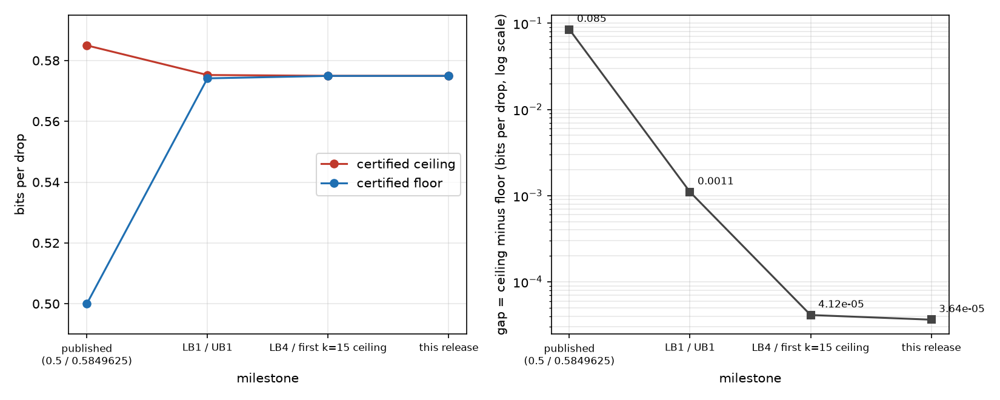

# Blackwell's trapdoor channel

**Certified capacity bounds 0.5749319 ≤ C ≤ 0.5749683 bits per drop, each end with a checkable certificate and an independent re-check**

Moki & Julio (AI-assisted) · 2026 · version 1.0 · DOI [10.5281/zenodo.24443961](https://doi.org/10.5281/zenodo.24443961)

  

> In 1961 David Blackwell asked how much information per use can pass through a box that holds one ball and drops one at random. The best proven interval we could find in print is 0.5 to 0.585. Here it is 0.5749319 to 0.5749683, about 2,300 times narrower.

## In plain words

A box holds one ball, black or white. You drop a ball in, and one of the two balls inside falls out at random. Someone watching the balls fall out tries to read your message. The capacity C is the most bits per drop you can get across. Nobody knows its exact value.

We give a number that C cannot be below (the floor) and a number that C cannot be above (the ceiling). The floor is the performance of one explicit recipe for choosing balls, with every rounding error of the computation bounded. The ceiling is a table of predictions about the falling balls; a theorem from 2019 and 2023 work says that if no input can surprise the table by more than r bits per drop, then C is at most r, and we check every case in exact arithmetic, rounding upward.

Both ends were re-checked by programs written by a referee who was given the definitions but not our code. The ceiling re-check is a full second verifier. The floor re-check is an exact evaluator that agrees with our kernel to about 3e-17 at depths 11 and 12; the full-depth floor (depth 24) rests on a written and refereed rounding-error proof. Nothing here says where C lies inside the interval, or that either recipe is best possible.

## Start here

1. Read [PAPER.md](PAPER.md). Its first section is in plain words.
2. Look at the figure and its caption below, then at the scorecard of sealed tests.
3. Re-check the ceiling yourself in under a second: [code/README.md](code/README.md) has one command per step. The headline floor and ceiling, their controls and the milestone ceilings are in shipped transcripts; the order-4 and order-7 floor values, the IEEE test and the solver timings are recorded in bars/RESULT-*.md and referees/. Transcripts: [transcripts/](transcripts/).

## The figure

**Figure: gap_history.png.** Left: the lower bound (blue) and upper bound (red) on C at four stages, from the best published rigorous interval (0.5 and 0.5849625) to this release (0.5749319 and 0.5749683, rounded outward to seven digits). Right: the width of the interval, ceiling minus floor, on its own log scale, falling from 0.085 to about 3.6e-5. The two bounds are now so close that they overlap on the left panel; the right panel is where the progress is visible. The values are those printed in PAPER.md and bars/RESULT-LB4.md, rounded outward to seven digits, so the last gap shown is 3.64e-5 where the paper's unrounded value is 3.632e-5. The script that drew it is [code/figure/make_gap_history.py](code/figure/make_gap_history.py).

## Results

| | value | what it is | how it was checked |
|---|---|---|---|
| Floor | **C ≥ 0.57493196741521** | a run-length input recipe (1,920 hidden states), certified at depth 24 (`CERTIFIED`) | rounding-error proof, two chunkings agree, a blind exact evaluator agrees to about 3e-17 at depth 11 and 12 |
| Ceiling | **C ≤ 0.574968285761** | an order-15 output model, dual bound (`CERTIFIED`) | exact verifier, plus a second verifier written by a referee from the definitions |
| Width | **3.632e-5** | | |
| Published, rigorous | 0.5 < C ≤ log2(3/2) = 0.5849625 | Kobayashi-Morita 2002 (as reported by Permuter et al. 2008); Huleihel et al. 2019, Theorem 7 | `CITED` |

The other published values (0.572, about 0.57246, 0.5765) and why they are not counted as proven bounds are in PAPER.md, "Start here". Both 0.572 and 0.57246 lie below our floor, so no theorem is contradicted.

## Scorecard (pre-registered tests)

The headline computations were predicted in a sealed file (hashed before the run, in [bars/](bars/)) and scored afterwards without moving the bar. Failures are kept. The order-13 ceiling row in PAPER.md section 3 was verified but not sealed. Chips: `HOLD` all predictions passed · `FAILED` at least one prediction failed (kept and reported, never re-scored) · `VOID` ran before its seal went through.

| test | what it checked | verdict |
|---|---|---|
| LB1 | order-4 floor 0.5741292, two exact evaluators | `HOLD` |
| LB2 | order-7 floor, independent exact re-evaluation | `HOLD` |
| LB3 | order-9 floor with the fast kernel | `FAILED` (our tolerance forgot a 14-digit print truncation) |
| LB4 | order-9 floor 0.57492740773047 with a proven log routine | `HOLD` |
| UB1 | ceiling 0.5752327, blind re-implementation of the verifier | `HOLD` |
| UB2 | ceiling certificates at sizes 8 and 10 | `HOLD` |
| UB3 | the shortcut ("collapse") cross-checked against the original chain, sizes 10 and 11 | `HOLD` |
| PUSH1 | this note's floor and ceiling | `FAILED` (one control could not fire: it perturbed a state the recipe never visits). Every value check passed. |
| PUSH1a | a first replacement control | `VOID` (it ran before its seal went through; kept only as an unsealed observation) |
| PUSH1b | a replacement live control, sealed before its run | `HOLD` |

## What each status means

`CERTIFIED` rigorous bound: exact integer or rational arithmetic plus interval (ball) logarithms, or a written rounding-error proof · `CITED` published by others, named · `ESTIMATE` extrapolation, not a bound (PAPER.md section 6 only) · `UNTESTED` a lead we noticed and did not test.

## What we do not claim

- That either recipe is optimal, or anything about where C lies inside the interval.
- A closed form for C.
- Any feedback capacity. The shortcut proof uses that the codeword is fixed in advance.
- That we are the first to tighten these bounds. We searched arXiv (abstracts and titles), Zenodo, OpenAlex and Semantic Scholar to 2026-11-22 and found no proven upper bound below 0.5849625 and no traceable proof of a lower bound above 0.5. Three sources could not be opened: Kobayashi, Morita and Hoshi (2003), Kobayashi (2006), and a 2025 doctoral thesis by Huleihel.

## How to re-check

From the package root. Each line is explained in [code/README.md](code/README.md); needs Python 3 with python-flint, mpmath, NumPy and SciPy.

| step | command | expected |
|---|---|---|
| ceiling, our verifier | `python code/ceiling/verify_collapsed.py data/ceiling/cert_col_k15_cont_claim.json` | `PASS`, 0.574968285761 |
| ceiling, negative control | `python code/ceiling/verify_collapsed.py data/ceiling/negctl_k15_cont_low.json` | `FAIL`, exit code 1 on purpose (the claim is one unit too low) |
| ceiling, referee's verifier | `python code/referee/ref_ub3_verify.py data/ceiling/cert_col_k15_cont_claim.json` | `PASS`, same value |
| floor kernel, depth 12 (about a minute) | `python code/floor/cert_backward2.py data/floor/fL6_10_8_6.txt 12` | `CERTIFIED LOWER ENDPOINT: 0.57470129676808` |
| floor, referee's evaluator, depths 10 to 12 | `python code/referee/td_ln.py data/floor/fL6_10_8_6.txt ../out.txt --levels 10,11,12` | matches `transcripts/referee-push1/` |
| floor, full depth (about 25 minutes, 6.4 GB) | `python code/floor/cert_backward2.py data/floor/fL6_10_8_6.txt 24 --nb 15` | `CERTIFIED LOWER ENDPOINT: 0.57493196741521` |

## Folder map

| folder or file | contents |
|---|---|
| [PAPER.md](PAPER.md) | the write-up: the channel, the floor, the ceiling, what it rests on, what it does not claim, where the gap could go |
| [bars/](bars/) | the sealed test files (BAR-*, AMENDMENT-*), the scoring notes (RESULT-*) and the seal hashes (SEALS-*) |
| [referees/](referees/) | the referee reports |
| [proofs/](proofs/) | the written proofs and the rounding-error lemma, with fixes |
| [code/](code/) | the floor kernel, the ceiling verifier, the two independent checkers, the figure script: [code/README.md](code/README.md) |
| [data/](data/) | the floor input, the ceiling certificates, the negative and perturbed controls, earlier milestone certificates |
| [transcripts/](transcripts/) | the logs behind the headline floor and ceiling, their controls and the milestone ceilings (other values: bars/RESULT-*.md and referees/) |
| [figures/](figures/) | gap_history.png |
| [references/](references/) | the builder's working notes cited in PAPER.md section 6 (not refereed) |
| [PATCHES.md](PATCHES.md), [FILELIST.md](FILELIST.md), `MANIFEST.sha256` | every change made to a copied file; every file with its source; checksums |

## Credits

D. Blackwell (the problem); Kobayashi, Morita and Hoshi, and Kobayashi (earlier bounds and estimates); Permuter, Cuff, Van Roy and Weissman; Huleihel, Sabag, Permuter, Kashyap and Shamai (the duality bound and the order-k special case); Huleihel, Sabag, Permuter and Kostina (delayed feedback); Chen and Sakai (the coin representation); Papailiopoulos, and Khodaiemehr, Feng and Duman (certified bounds for deletion channels); J. J. Birch (the entropy-rate bound); Gallager (indecomposable channels). Full list in PAPER.md. Software: Python, python-flint (Arb), mpmath, NumPy, SciPy, matplotlib.

## Loose ends

- **Assumption A1 not proven.** The floor assumes the computer's +, −, ×, ÷ on doubles round correctly (IEEE 754). It was tested on this build (0 mismatches in 40,004 samples per operation), not proven.
- **Gallager's theorem not opened.** Used for "the channel is indecomposable, so C does not depend on the starting ball" (Gallager, Ch. 4.6 and 5.9); cited from the textbook, which we did not open.
- **Three sources unopened.** Kobayashi, Morita and Hoshi (2003), Kobayashi (2006), and a 2025 doctoral thesis by Huleihel. So the status of the 0.572 value is not settled by a primary source.
- **The order-13 ceiling row is unsealed.** It was verified, but no sealed prediction preceded it.
- **The full-depth floor was not independently re-evaluated.** The referee's evaluator was run at depths 11 and 12 only; depth 24 rests on the refereed error proof and on two chunkings of our kernel agreeing.
- **Nothing here is about optimality.** The floor recipe and the ceiling model are not claimed to be the best of their kind.

## Open doors

Honest next questions (PAPER.md section 6; estimates, not claims):

- **How far can the ceiling family go?** Each added order improves the ceiling by less than the one before (ratios about 0.64 to 0.73) while the work grows 2.6 to 6 times per order. Extrapolating puts the limit of this family between the certified floor and about 0.57496 (`ESTIMATE`). Is that extrapolation right?
- **Is there a smarter output model?** Models that also remember run lengths did not help at equal size (the plain order-k model is better by 1e-4 to 4e-4). Is there a model of a different kind that does?
- **Can the floor and ceiling meet?** Larger run-length inputs add under 1e-6 each at double the cost. A large further factor needs a new idea, not more compute: what would it be?

## Cite

Moki & Julio (AI-assisted), "Blackwell's trapdoor channel: certified capacity bounds 0.5749319 ≤ C ≤ 0.5749683", version 1.0, 2026, Zenodo, https://doi.org/10.5281/zenodo.24443961. See [CITATION.cff](CITATION.cff).

## Licence

Text, data, sealed files, referee reports, proofs and transcripts: CC BY 4.0 ([LICENSE](LICENSE)). Code: MIT ([LICENSE-CODE](LICENSE-CODE)).

Written with AI assistance.
